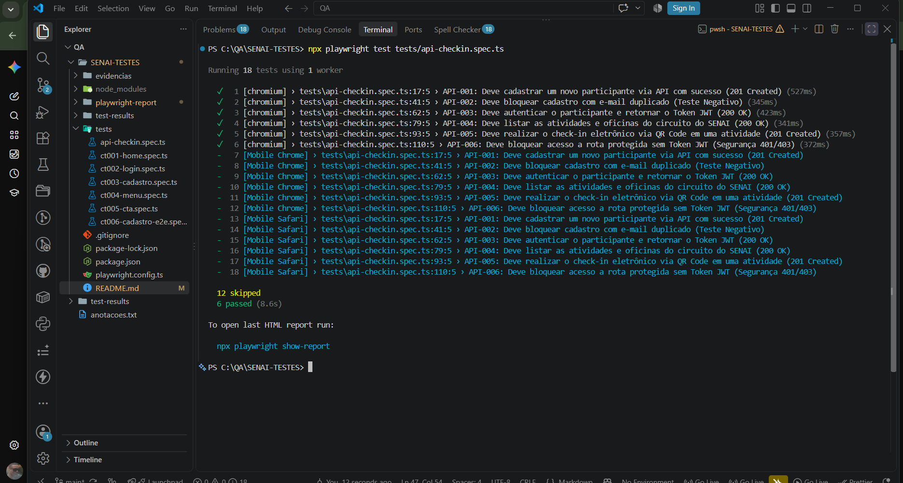
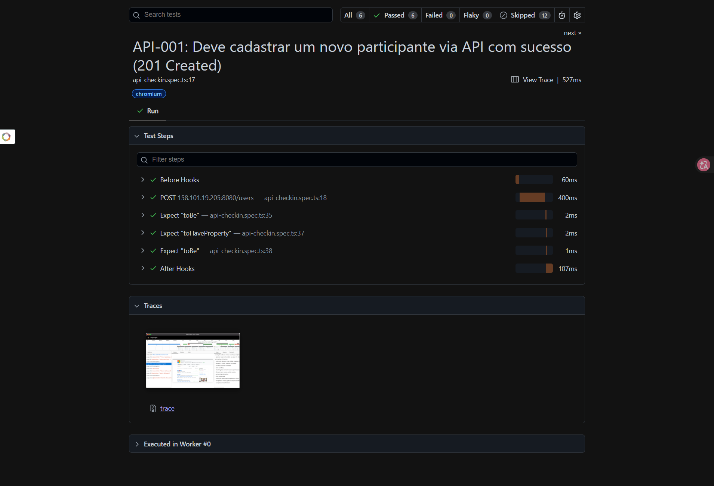
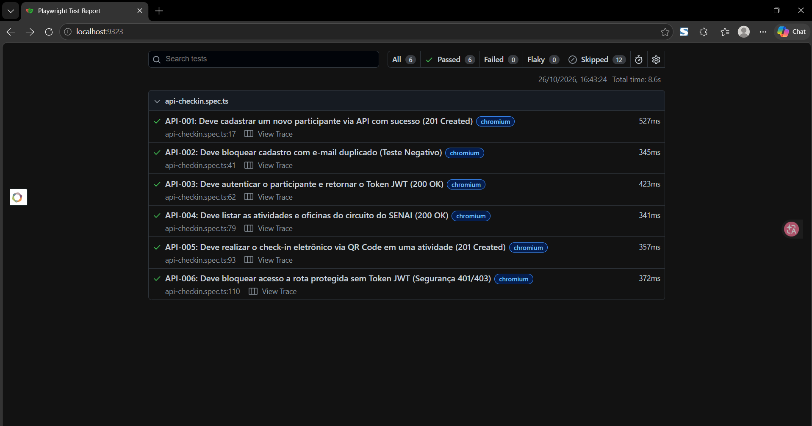
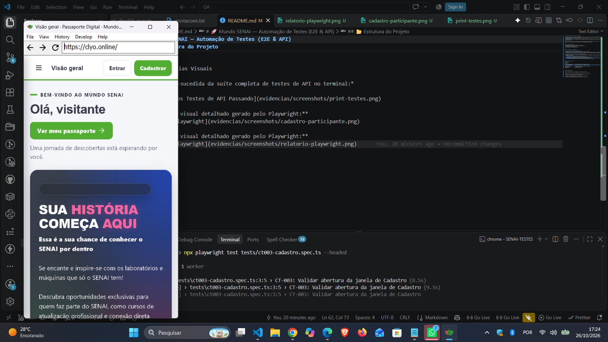

# 🚀 Mundo SENAI — Automação de Testes (E2E & API)

[](https://github.com/jonatasribeiro82/meus-testes-qa-senai/actions)
[](https://github.com/jonatasribeiro82/meus-testes-qa-senai)
[](https://github.com/jonatasribeiro82/meus-testes-qa-senai)

Repositório oficial de automação de testes do projeto **Passaporte Digital — Mundo SENAI**. O projeto cobre a validação de ponta a ponta (E2E) da interface web e testes de integração/contrato no backend em Java/Spring Boot.

---

## 🛠️ Tecnologias Utilizadas
* **TypeScript / JavaScript** (Linguagem base dos scripts)
* **Playwright Test** (Framework moderno de automação E2E e API)
* **Node.js** (Ambiente de execução)
* **Git & GitHub** (Versionamento e CI/CD)

---

## 🧪 Pirâmide de Testes Implementada

### 1. Topo da Pirâmide: Testes E2E (Interface / UI)
* **Cobertura:** 18 testes automatizados validando a experiência do utilizador.
* **Escopos:** Fluxos de login, cadastro com validações de regras de negócio, navegação pelo circuito de oficinas e interações visuais.
* **Multiplataforma:** Executado e validado em **Desktop (Chromium)**, **Mobile Chrome (Android)** e **Mobile Safari (iOS)**.

### 2. Meio da Pirâmide: Testes de API & Integração (`CheckIn-API`)
* **Cobertura:** 6 testes de contrato e integração batendo diretamente no backend Java (`http://158.101.19.205:8080`)[cite: 1].
* **Endpoints Validados:**
  * `POST /users` (Cadastro de participantes com validação de status `201` e tratamento de duplicidade)[cite: 1].
  * `POST /auth/login` (Autenticação e emissão de Token JWT)[cite: 1].
  * `GET /activities` (Listagem dinâmica do circuito de oficinas do SENAI)[cite: 1].
  * `POST /checkins` (Simulação de check-in autenticado via QR Code)[cite: 1].
  * `GET /users` (Testes de segurança e bloqueio de rotas sem autorização `401/403`)[cite: 1].

---

## 📂 Estrutura do Projeto
```text
SENAI-TESTES/
│
├── tests/
│   ├── e2e-fluxos.spec.ts     # Testes de Interface e E2E (Desktop & Mobile)
│   └── api-checkin.spec.ts    # Testes de Integração e API (Backend Java)
│
├── playwright.config.ts       # Configurações globais de projetos e navegadores
├── package.json               # Dependências do projeto
└── README.md                  # Documentação oficial


---

## 📊 Evidências Visuais

*Execução bem-sucedida da suíte completa de testes de API no terminal:*



> **Relatório visual detalhado gerado pelo Playwright:**


> **Relatório visual detalhado gerado pelo Playwright:**


---

> **Testes E2E (Interface) em execução real multiplataforma:**
